# Pipeline architecture

The workflow is intentionally shown as a relationship graph rather than a
claim that every runtime implementation is a pure DAG. Airflow schedules the
same seams that the standalone scripts expose for local operation.

```mermaid
flowchart LR
    takeout["Manual Google Takeout request"] --> raw["data/ dated extracted trees"]
    raw --> copy["takeout_intake.py\ncopy + SHA-256 manifest"]
    copy --> inbox["Ignored inbox/"]
    inbox --> discover["Discover archives or MyActivity.json"]
    discover --> safe["Validate archive\nextract safely"]
    safe --> normalize["activity_pipeline.py\nnormalize records"]
    normalize --> taxonomy["taxonomy.py\none allowlisted category"]
    taxonomy --> privacy["privacy_filter.py\nredact + block high risk"]
    privacy --> prefilter["Deterministic gate\nlow evidence + duplicates"]
    prefilter --> surgeon["content_article_surgeon.py\nclean + conservative split"]
    surgeon --> brief["Build document brief"]
    brief --> score["public_interest_scorer.py\nscore dimensions"]
    score --> decision{"Disposition"}
    decision --> rewrite["article_rewriter.py\nresearch + rewrite"]
    decision --> review["Editorial review queue"]
    decision --> reject["Reject + ledger"]
    rewrite --> validate["migrate + validate + tests"]
    validate --> publish["Atomic publish\ncategory slug folder"]
    review --> override["Explicit override\nreason recorded"]
    override --> validate

    codex["Codex Python SDK\nChatGPT OAuth / app-server"] --> model["gpt-5.6-luna\nreasoning max"]
    gateway["Docker host gateway\nbearer token"] --> codex
    local["Local OpenAI-compatible\nfallback"] --> fallback["Fallback metadata\nreason + actual provider"]
    model --> fallback
    brief -.-> gateway
    score -.-> gateway
    rewrite -.-> gateway
    research["research.py\nCodex web search + citations"] -.-> gateway
    research --> rewrite

    airflow["Airflow DAG"] --> discover
    airflow --> gateway
    host["Host standalone scripts"] --> codex
```

The dashed edges represent provider calls. Content remains in the staging
workspace until the deterministic publication checks succeed. Provider
failures may use the configured local fallback, but the fallback reason is
written beside the score/rewrite result rather than hidden.
